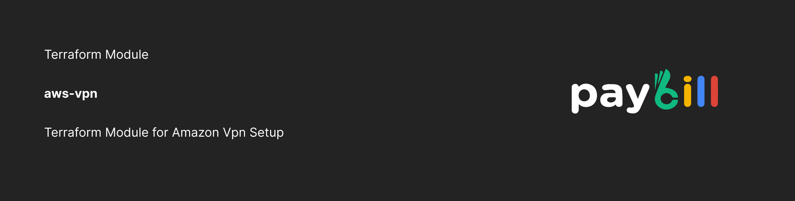

  <a href="https://paybill.dev" target="_blank">
    <picture>
      
    </picture>
  </a>

### AWS VPN Terraform Module

This Terraform configuration module automates the deployment of a secure **AWS Client VPN environment**. It includes:

* **Security Groups**: Configurable ingress and egress rules to control traffic to and from the VPN endpoint.
* **Certificates**: Optional creation of self-signed TLS certificates for the VPN server, stored in ACM and SSM, enabling secure encrypted connections.
* **VPN Infrastructure**: Creation of a Client VPN endpoint, associated VPN gateway, and optional SAML-based IAM provider for federated authentication. Supports split-tunnel configurations, self-service portal, DNS servers, and logging via CloudWatch.
* **Network Associations**: Associates the VPN endpoint with one or more subnets for client connectivity.
* **Authorization Rules**: Defines access permissions to target networks, supporting either group-based or open access.
* **Customizability**: Extensive variables allow customization of authentication type (certificate, Active Directory, or SAML), transport protocol, additional security groups, client IP ranges, logging, and certificate details.
* **Outputs**: Provides key resources’ identifiers, such as VPN ARN, VPN ID, and self-signed certificate ARN.

Overall, the module enables fully automated and configurable setup of a secure AWS Client VPN, suitable for enterprise networking and remote access needs.

<!-- BEGIN_TF_DOCS -->
## Requirements

| Name | Version |
|------|---------|
|  [terraform](#requirement\_terraform) | >= 1.3.0 |
|  [aws](#requirement\_aws) | >= 5.0.0 |

## Providers

| Name | Version |
|------|---------|
|  [aws](#provider\_aws) | >= 5.0.0 |

## Modules

| Name | Source | Version |
|------|--------|---------|
|  [self\_signed\_cert](#module\_self\_signed\_cert) | git::https://github.com/cloudposse/terraform-aws-ssm-tls-self-signed-cert.git | 1.3.0 |

## Resources

| Name | Type |
|------|------|
| [aws_ec2_client_vpn_authorization_rule.this](https://registry.terraform.io/providers/hashicorp/aws/latest/docs/resources/ec2_client_vpn_authorization_rule) | resource |
| [aws_ec2_client_vpn_endpoint.this](https://registry.terraform.io/providers/hashicorp/aws/latest/docs/resources/ec2_client_vpn_endpoint) | resource |
| [aws_ec2_client_vpn_network_association.this](https://registry.terraform.io/providers/hashicorp/aws/latest/docs/resources/ec2_client_vpn_network_association) | resource |
| [aws_iam_saml_provider.this](https://registry.terraform.io/providers/hashicorp/aws/latest/docs/resources/iam_saml_provider) | resource |
| [aws_security_group.vpn](https://registry.terraform.io/providers/hashicorp/aws/latest/docs/resources/security_group) | resource |
| [aws_vpn_gateway.this](https://registry.terraform.io/providers/hashicorp/aws/latest/docs/resources/vpn_gateway) | resource |

## Inputs

| Name | Description | Type | Default | Required |
|------|-------------|------|---------|:--------:|
|  [authentication\_options\_active\_directory\_id](#input\_authentication\_options\_active\_directory\_id) | The ID of the Active Directory to be used for authentication if type is directory-service-authentication. | `string` | `null` | no |
|  [authentication\_options\_root\_certificate\_chain\_arn](#input\_authentication\_options\_root\_certificate\_chain\_arn) | The ARN of the client certificate. The certificate must be signed by a certificate authority (CA) and it must be provisioned in AWS Certificate Manager (ACM). Only necessary when type is set to certificate-authentication. | `string` | `null` | no |
|  [authentication\_options\_saml\_provider\_arn](#input\_authentication\_options\_saml\_provider\_arn) | The ARN of the IAM SAML identity provider if type is federated-authentication. | `string` | `null` | no |
|  [authentication\_options\_self\_service\_saml\_provider\_arn](#input\_authentication\_options\_self\_service\_saml\_provider\_arn) | The ARN of the IAM SAML identity provider for the self service portal if type is federated-authentication. | `string` | `null` | no |
|  [authentication\_options\_type](#input\_authentication\_options\_type) | The type of client authentication to be used. Specify certificate-authentication to use certificate-based authentication, directory-service-authentication to use Active Directory authentication, or federated-authentication to use Federated Authentication via SAML 2.0. | `string` | n/a | yes |
|  [client\_cidr](#input\_client\_cidr) | The IPv4 address range, in CIDR notation, from which to assign client IP addresses. | `string` | n/a | yes |
|  [client\_server\_certificate\_arn](#input\_client\_server\_certificate\_arn) | The ARN of the ACM server certificate. | `string` | `null` | no |
|  [client\_server\_transport\_protocol](#input\_client\_server\_transport\_protocol) | The transport protocol to be used by the VPN session. | `string` | `"tcp"` | no |
|  [client\_vpn\_access\_group\_id](#input\_client\_vpn\_access\_group\_id) | The ID of the group to which the authorization rule grants access. One of access\_group\_id or authorize\_all\_groups must be set. | `string` | `null` | no |
|  [client\_vpn\_additional\_security\_group\_ids](#input\_client\_vpn\_additional\_security\_group\_ids) | Additional IDs of security groups to add to the target network. | `list(string)` | `[]` | no |
|  [client\_vpn\_authorize\_all\_groups](#input\_client\_vpn\_authorize\_all\_groups) | Indicates whether the authorization rule grants access to all clients. One of access\_group\_id or authorize\_all\_groups must be set. | `bool` | `true` | no |
|  [client\_vpn\_egress\_rules](#input\_client\_vpn\_egress\_rules) | Egress rules for the security groups. | <pre>list(object({     description        = optional(string, "")     from_port          = number     to_port            = number     protocol           = any     cidr_blocks        = optional(list(string), [])     security_group_ids = optional(list(string), [])     ipv6_cidr_blocks   = optional(list(string), [])   }))</pre> | <pre>[   {     "cidr_blocks": [       "0.0.0.0/0"     ],     "description": "VPN egress to internet",     "from_port": 0,     "protocol": -1,     "to_port": 0   } ]</pre> | no |
|  [client\_vpn\_gateway\_name](#input\_client\_vpn\_gateway\_name) | The name of the client vpn gateway. | `string` | n/a | yes |
|  [client\_vpn\_ingress\_rules](#input\_client\_vpn\_ingress\_rules) | Ingress rules for the security groups. | <pre>list(object({     description        = optional(string, "")     from_port          = number     to_port            = number     protocol           = any     cidr_blocks        = optional(list(string), [])     security_group_ids = optional(list(string), [])     ipv6_cidr_blocks   = optional(list(string), [])   }))</pre> | <pre>[   {     "description": "VPN ingress to 443",     "from_port": 443,     "protocol": "tcp",     "to_port": 443   } ]</pre> | no |
|  [client\_vpn\_log\_options](#input\_client\_vpn\_log\_options) | Whether logging is enabled and where to send the logs output. | <pre>object({     enabled               = bool                   // Indicates whether connection logging is enabled     cloudwatch_log_stream = optional(string, null) // The name of the vpn client cloudwatch log stream     cloudwatch_log_group  = optional(string, null) // The name of the vpn client cloudwatch log group   })</pre> | <pre>{   "enabled": false }</pre> | no |
|  [client\_vpn\_name](#input\_client\_vpn\_name) | The name of the client vpn | `string` | n/a | yes |
|  [client\_vpn\_self\_service\_portal](#input\_client\_vpn\_self\_service\_portal) | Specify whether to enable the self-service portal for the Client VPN endpoint. Values can be enabled or disabled. | `string` | `"disabled"` | no |
|  [client\_vpn\_split\_tunnel](#input\_client\_vpn\_split\_tunnel) | Indicates whether split-tunnel is enabled on VPN endpoint. | `bool` | `true` | no |
|  [client\_vpn\_subnet\_ids](#input\_client\_vpn\_subnet\_ids) | The ID of the subnets to associate with the Client VPN endpoint. | `list(string)` | n/a | yes |
|  [client\_vpn\_target\_network\_cidr](#input\_client\_vpn\_target\_network\_cidr) | The IPv4 address range, in CIDR notation, of the network to which the authorization rule applies. | `string` | n/a | yes |
|  [create\_self\_signed\_server\_cert](#input\_create\_self\_signed\_server\_cert) | Create a self signed certificate to use for the VPN server. | `bool` | `true` | no |
|  [dns\_servers](#input\_dns\_servers) | The list of dns server ip address | `list(string)` | <pre>[   "1.1.1.1",   "1.0.0.1" ]</pre> | no |
|  [iam\_saml\_provider\_enabled](#input\_iam\_saml\_provider\_enabled) | Enable the SAML provider for SSO login to Client VPN. If enabled, `var.iam_saml_provider_name` and `var.saml_metadata_document_content` must be set. | `bool` | `false` | no |
|  [iam\_saml\_provider\_name](#input\_iam\_saml\_provider\_name) | The name of the IAM SAML Provider | `string` | `null` | no |
|  [saml\_metadata\_document\_content](#input\_saml\_metadata\_document\_content) | The content of the saml metadata document | `string` | `null` | no |
|  [self\_signed\_server\_cert\_allowed\_uses](#input\_self\_signed\_server\_cert\_allowed\_uses) | List of keywords each describing a use that is permitted for the issued certificate. Must be one of of the values outlined in [self\_signed\_cert.allowed\_uses](https://registry.terraform.io/providers/hashicorp/tls/latest/docs/resources/self_signed_cert#allowed_uses). | `list(string)` | <pre>[   "key_encipherment",   "digital_signature",   "server_auth" ]</pre> | no |
|  [self\_signed\_server\_cert\_ca\_pem](#input\_self\_signed\_server\_cert\_ca\_pem) | Server certificate CA PEM | `string` | `""` | no |
|  [self\_signed\_server\_cert\_organization\_name](#input\_self\_signed\_server\_cert\_organization\_name) | Organization name to assign the server certificate | `string` | `""` | no |
|  [self\_signed\_server\_cert\_private\_ca\_key\_pem](#input\_self\_signed\_server\_cert\_private\_ca\_key\_pem) | Server certificate Private Key PEM | `string` | `""` | no |
|  [self\_signed\_server\_cert\_secret\_path\_format](#input\_self\_signed\_server\_cert\_secret\_path\_format) | The path format to use when writing secrets to the certificate backend. | `string` | `"/%s.%s"` | no |
|  [self\_signed\_server\_cert\_server\_common\_name](#input\_self\_signed\_server\_cert\_server\_common\_name) | Common name to assign the server certificate | `string` | `""` | no |
|  [tags](#input\_tags) | Default tags to apply to every applicable resource | `map(string)` | n/a | yes |
|  [vpc\_id](#input\_vpc\_id) | The ID of the target network VPC | `string` | n/a | yes |

## Outputs

| Name | Description |
|------|-------------|
|  [client\_self\_signed\_cert\_server\_certificate\_arn](#output\_client\_self\_signed\_cert\_server\_certificate\_arn) | Self signed certificate server certificate ARN |
|  [client\_vpn\_arn](#output\_client\_vpn\_arn) | The client vpn ARN |
|  [client\_vpn\_id](#output\_client\_vpn\_id) | The client vpn ID |
<!-- END_TF_DOCS -->